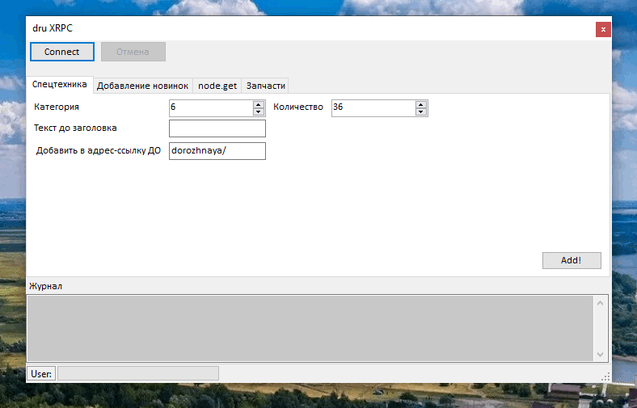

# drU6-XRPC

Программа для импорта Excel-таблиц в Drupal по XML-RPC
(C# / .NET Framework 4.0). Создаёт и обновляет узлы на сайте
через модуль Drupal Services; подпись запросов — HMAC-SHA256.

## Возможности

* XML-RPC-команды: `system.connect`, `user.login`, `node.get`, `node.save`, `user.logout`.
* Вкладка **node.get** — просмотр узла (заголовок, body).
* Импорт из Excel: **Добавление новых моделей**, **Спецтехника**, **Запчасти**
  (файлы и настройки — в `App.config`, раздел `Excel*`).
* Отмена длительной операции кнопкой «Отмена».

## Сборка и запуск

* Visual Studio 2010+ / .NET Framework 4.0+
* Зависимости лежат в `Required\` (CookComputing.XmlRpcV2,
  MolineSoftware.DrupalXmlRpc, Interop.Excel).
* Книги Excel из проекта копируются в папку сборки.

## Настройки

Настройки подключения находятся в файлел `App.config`:

* `Drupal.ServiceUrl`, `Drupal.ServiceDomain`, `Drupal.ServiceKey` — endpoint
  Drupal и ключ подписи HMAC

